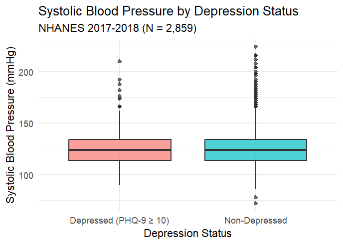

# NHANES Depression & Blood Pressure Analysis

## Overview
This repository contains the reproducible code for a secondary data analysis of the National Health and Nutrition Examination Survey (NHANES) 2017-2018 cycle. 

**Research Question:** Is there an association between depressive symptoms (PHQ-9) and systolic blood pressure in US adults?

**Preregistration:** This study was preregistered on the Open Science Framework (OSF).  
🔗 [Link to OSF Preregistration](https://doi.org/10.17605/OSF.IO/ZUXKY)

## Data Source
*   **Dataset:** NHANES 2017-2018 (CDC)
*   **Files Used:** `DEMO_J.xpt`, `DPQ_J.xpt`, `BPX_J.xpt`

## Project Structure
*   `data/`: Raw and cleaned data files.
*   `scripts/`: R or Python scripts for data cleaning and analysis.
*   `output/`: Generated graphs and tables.

## How to Reproduce
1. Download the raw NHANES files from the CDC website.
2. Place them in the `data/raw/` folder.
3. Run the script `01_data_cleaning.R` (or `.py`) to prepare the dataset.
4. Run the script `02_analysis.R` (or `.py`) to generate results and figures.

## License
This project is licensed under the MIT License.

## Preliminary Results

## 🛠️ Developer Notes & Challenges

*   **Data Merging:** One of the biggest challenges was merging the Demographics (`DEMO_J`) and Blood Pressure (`BPX_J`) files, as not all participants had valid MEC exam data. I used `left_join` to ensure we didn't lose participants who had interview data but missing exam values.
*   **Variable Selection:** Identifying the correct pregnancy status variable (`RIDEXPRG`) required cross-referencing the NHANES codebook, as the standard `RIDPREG` was not present in this cycle's demo file.
*   **Reproducibility:** This project was built with a "reproducible first" mindset. All data cleaning steps are documented in `01_data_cleaning.R` to ensure that any researcher can replicate these exact results from the raw .xpt files.
